# 尺素全部图标 · 鸿蒙对照

> 2026-11-07 iOS 侧出，对应更新包 **U19**（设置全部页面详解）。由 `Scripts/make_harmony_icon_catalog.py` 生成，**不要手改**（改脚本里的表再重跑）。
> 设置各页每一行用哪个图标、放在哪，见同级目录 `../settings_pages/SETTINGS_PAGES.md`；这份按「图标」列全 App。

## 先读这四条

1. **App 里的图标分两种**：尺素**自己画的**（设置首页那套线条、火漆印、手写 m. …）→ 给图片，拿来就放；iOS 用苹果 **SF Symbols** 的 → 不给图片，用鸿蒙系统自带的 **HarmonyOS Symbol**
2. 🔴 **SF Symbols 不许用到鸿蒙上**（苹果的授权只许用在苹果的平台）：不要截 iOS 的图标、不要描、不要找网上的 SF Symbols 素材
3. HarmonyOS Symbol 的名字取自华为官方图标库（[developer.huawei.com/consumer/cn/design/harmonyos-symbol](https://developer.huawei.com/consumer/cn/design/harmonyos-symbol/)，名字表 v2.3）。用法：
   ```ts
   SymbolGlyph($r('sys.symbol.bell'))
     .fontSize(14)                       // 设置二级页行首 14vp（和 iOS 同号，占 20vp 宽）；别处照 iOS 那一处的大小
     .fontColor([主题的图标线色])          // 单色，颜色跟主题（见 settings_icons/GUIDE.md 的颜色表）
   ```
   表里标「图标库网页没列，字体里有」的，是鸿蒙系统字体里有、但官方图标库网页没展示的名字 —— 在 DevEco 里输 `sys.symbol.` 看补全核对；真没有就用同一行「意思」找一个最接近的，并告诉 iOS 侧改表。一部分老图标在系统里是 `ohos_` 开头（如 `sys.symbol.ohos_trash`），两个都有时用不带前缀的
4. 表里的小图（`harmony_symbols/`）是拿官方字体画的**预览**，只给人看，**不要拷进工程** —— 工程里用 `sys.symbol.*`，系统会跟着字号、粗细、深浅色画

---

## 一、尺素自己画的（给图片）

### 设置首页（U10 已交付，图在 `../settings_icons/`）

四套主题各一套、带好了圆框和颜色，怎么放见 `../settings_icons/GUIDE.md`。下面是素笺那套：

| 图 | 文件名（`<主题>` 换成主题 id） | 用在哪 |
|---|---|---|
|  | `ic_settings_appearance_<主题>` | 外观 |
|  | `ic_settings_journal_<主题>` | 日记 |
|  | `ic_settings_penpal_<主题>` | 笔友 |
|  | `ic_settings_location_<主题>` | 位置与天气 |
|  | `ic_settings_language_<主题>` | 语言 |
|  | `ic_settings_data_<主题>` | 数据与备份 |
|  | `ic_settings_stats_<主题>` | 写作统计 |
|  | `ic_settings_rate_<主题>` | 给我们评分（华为应用市场的购物袋） |
|  | `ic_settings_feedback_<主题>` | 反馈与建议 |
|  | `ic_settings_about_<主题>` | 关于 |
|  | `ic_follow_xiaohongshu_<主题>` | 关注我们 · 小红书 |
|  | `ic_follow_douyin_<主题>` | 关注我们 · 抖音 |
|  | `ic_follow_weibo_<主题>` | 关注我们 · 微博 |
|  | `img_avatar_mark_<主题>` | 账户卡头像（手写 m.） |

### 火漆印（尺素会员）—— 这次新出

一枚深红的蜡、边缘不规则地溢开一圈、中间压一个字。拿 iOS 的 `Views/Components/WaxSeal.swift` 原样画出来的。四套主题都是**同一个颜色**（蜡的颜色不跟主题）。

| 图 | 文件 | 说明 |
|---|---|---|
|  | `wax_seal/img_wax_seal_blank.png` | 空白印面（鸿蒙用这张，上面自己压字） |
| 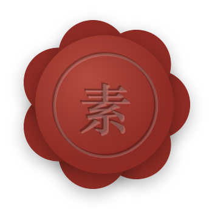 | `wax_seal/sample_wax_seal_su.png` | 样张：没有昵称时压「素」 |
| 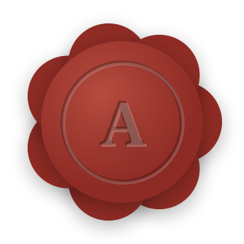 | `wax_seal/sample_wax_seal_A.png` | 样张：昵称 Alice → A |
| 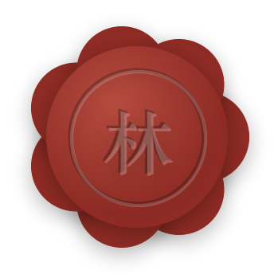 | `wax_seal/sample_wax_seal_lin.png` | 样张：昵称 林间 → 林 |
|  | `wax_seal/sample_wax_seal_row_26pt.png` | 样张：设置首页那行的大小（26pt） |
|  | `wax_seal/img_member_badge.png` | 会员款小标记（压「素」，16–18pt，固定的，直接用） |

**用在哪**（大小是印本身的直径）：

| 位置 | 大小 | 压什么字 |
|---|---|---|
| 设置首页「尺素会员」那一行的行首（不套框，占 30vp 宽，和下面各行的字对齐） | 26vp | 用户昵称的首字 |
| 付费页顶上 | 68vp | 用户昵称的首字 |
| 会员页（已开通，设置 → 尺素会员）顶上 | 60vp | 用户昵称的首字 |
| 会员款旁边的小标记，**只给还不是会员的人看**：设置 → 日记 → 照片相纸样式（字后面）、尺素相机选相纸、日记本封面版式（右上角） | 16vp | 固定「素」→ 直接用 `img_member_badge.png` |
| 同上：写日记插照片时选相纸（右上角） | 18vp | 同上 |
| 写作统计「情绪小结」卡片标题后面（不是会员时） | 15vp | 同上 |
| 读完一封来信，页底一行「想让笔友每篇都回？了解尺素会员」的行首（不是会员时，点了开付费页） | 16vp | 同上 |

小标记的图四周也留了影子的边：**印的直径 = 图片边长 × 18 ⁄ 30**，要显示 S vp 的印，图片放 `S × 30 ⁄ 18` vp 见方。读屏念「尺素会员」。

**压什么字**（照 iOS `WaxSeal.initial(of:)`）：昵称去掉首尾空白后的第一个字；中文取第一个字，拉丁字母取首字母并大写；没昵称、或第一个字是表情 / 符号 / 数字 → 压「素」。

**鸿蒙怎么压字**：每个人的字不一样，做不成固定图 —— 放空白印面 `img_wax_seal_blank.png`，上面叠两层同样的字：

- 图片四周留了影子的边：**印本身的直径 = 图片边长 × 68 ⁄ 86**。所以要显示 S vp 的印，图片放 `S × 86 ⁄ 68` vp 见方，字的中心 = 图片中心
- 字号 `S × 0.32`，**衬线、半粗**（iOS 是系统衬线体 New York；鸿蒙用系统里有的衬线中文字体，没有就用 HarmonyOS Sans 半粗）
- 底层：黑色、不透明度 28%；上层：白色、不透明度 22%，往右下各偏 `S × 0.012` —— 压进蜡里、一边受光的样子
- 印面的字**不翻译、不跟语言变**；读屏念「尺素会员」，不念那个字
- 对照样张 `sample_wax_seal_*.png` 验收

### 其他自己画的部件（不是小图标，规格在各自的更新包里）

| 是什么 | 规格在哪 | iOS 源码 |
|---|---|---|
| 手写 m.（桌面图标、开场、账户卡头像、锁屏提醒） | U09（字形）、U17（矢量母版） | `Views/Splash/HandwrittenMark.swift` |
| 邮戳上的 Sinara 标、精装 PDF 版权页的标 | U05、U08 | `Assets.xcassets/SinaraMark` |
| 火漆信封口的火漆（压笔友名字的首字） | U01 / U05 草稿 | `Views/PostBox/Envelope/SealedEnvelope.swift`（同一个 `WaxSeal`） |
| 投信那叠信上的勾选小方框 | U05 草稿 | `Views/PostBox/Posting/OutgoingPile.swift` 的 `CheckMark` |
| 拆信 / 推信的手势示意（箭头） | U13 草稿 | `Views/PostBox/Envelope/SealedLetterOpener.swift` 的 `GestureCue` |
| 世界地图上的「你」和笔友墨点 | U01 草稿 | `Views/PostBox/WorldMap/PenPalMapMarks.swift` |
| 心情标记前的小圆点（九档各一色） | U03 | `Views/Components/MoodBadge.swift` |
| 心情页的线团爱心 | U03 | `Views/Mood/ScribbleHeartDrawing.swift` |
| 日记本封面、书脊、杂志封面 | U07 | `Views/Home/BookCoverView.swift`、`Shelf/ShelfBookView.swift` |

---

## 二、iOS 用 SF Symbols 的每一处 → 鸿蒙系统图标

「iOS」一列只为说明是哪个图标、方便对照 iOS 源码，**鸿蒙不要找它的图**。同一个意思在不同页用同一个鸿蒙图标。

### 底栏、提示条、桌面快捷方式

| 预览 | 鸿蒙 `sys.symbol.` | 位置 | 意思 | iOS | 备注 |
|---|---|---|---|---|---|
|  | `book_pages_fill_1`<br>小说 | 底栏「记录」 | 日记 | `book.fill` |  |
|  | `books_vertical_fill`<br>（图标库网页没列，字体里有，DevEco 里核对） | 底栏「日记本」 | 一排书 | `books.vertical.fill` |  |
|  | `envelope_fill`<br>邮件/消息 | 底栏「邮筒」 | 信 | `envelope.fill` |  |
|  | `gearshape`<br>设置 | 底栏「设置」 | 齿轮 | `gearshape` |  |
|  | `magnifyingglass`<br>搜索/查询/查找/search | 底栏最右的搜索（设置里打开才有，U12） | 搜索 | `magnifyingglass` |  |
|  | `checkmark_circle`<br>清单/钩/勾选 | 顶上提示条：成功 | 成功 | `checkmark.circle` |  |
|  | `exclamationmark_circle`<br>异常、错误/感叹号 | 顶上提示条：失败 | 出错 | `exclamationmark.circle` |  |
|  | `info_circle`<br>模式详情 | 顶上提示条：提醒 | 提示 | `info.circle` |  |
|  | `square_grid_2x2`<br>检测项_应用 | 桌面长按图标的快捷菜单「应用图标」 | 应用 | `app.badge` | 鸿蒙仓库 7662e71 已用这个 |

### 设置首页（行首图标是自己画的，见第一节；这里是行尾）

| 预览 | 鸿蒙 `sys.symbol.` | 位置 | 意思 | iOS | 备注 |
|---|---|---|---|---|---|
|  | `chevron_right`<br>下一步/向右 | 进下一页的行尾 > | 进入 | `chevron.right` |  |
|  | `arrow_right_up_and_square`<br>新页签打开 | 外跳的行尾 ↗（给我们评分、反馈与建议、关注我们） | 跳到别的 App | `arrow.up.right` | 官方中文名「新页签打开」 |

### 设置 → 外观

| 预览 | 鸿蒙 `sys.symbol.` | 位置 | 意思 | iOS | 备注 |
|---|---|---|---|---|---|
| 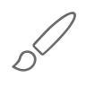 | `paintbrush`<br>画笔 | 「主题选择」行 | 画笔 | `paintbrush` |  |
|  | `square_grid_2x2`<br>检测项_应用 | 「应用图标」行 | 应用 | `app.badge` | 同桌面快捷方式 |
|  | `wand_and_stars`<br>（图标库网页没列，字体里有，DevEco 里核对） | 「启动动画」行 | 闪光 | `sparkles` |  |
|  | `magnifyingglass`<br>搜索/查询/查找/search | 「搜索日记」行 | 搜索 | `magnifyingglass` |  |
|  | `rectangle_on_rectangle`<br>相册 | 「手记页」行（当前是大屏时） | 一张叠一张 | `rectangle.on.rectangle` | 图标跟着当前选的样式换 |
|  | `list_bullet`<br>项目符号-圆点 | 「手记页」行（当前是列表时） | 列表 | `list.bullet` |  |
|  | `checkmark_circle_fill`<br>口算批改/钩/勾选 | 主题选择页：选中的那套主题右边 | 已选 | `checkmark.circle.fill` |  |
|  | `chevron_down`<br>向下 | 主题介绍弹窗：「出处」收起时 | 展开 | `chevron.down` |  |
|  | `chevron_up`<br>向上 | 主题介绍弹窗：「出处」展开时 | 收起 | `chevron.up` |  |
|  | `paintbrush`<br>画笔 | 应用图标页：「跟随主题」那一格 | 画笔 | `paintbrush` |  |
|  | `checkmark`<br>确认/钩/勾选 | 应用图标页：选中的那个右边 | 已选 | `checkmark` |  |
|  | `picture`<br>图片 | 应用图标页：图标素材缺了时的占位 | 图片 | `photo` | 正常看不到 |

### 设置 → 日记

| 预览 | 鸿蒙 `sys.symbol.` | 位置 | 意思 | iOS | 备注 |
|---|---|---|---|---|---|
|  | `picture`<br>图片 | 「照片相纸样式」行 | 照片 | `photo.on.rectangle` |  |
|  | `calendar`<br>日历 | 「封条提醒天数」行 | 日历 | `calendar.badge.exclamationmark` | 这一行鸿蒙不做（v1 Q10），列出来备查 |
|  | `bell`<br>响铃、通知/铃声/铃铛 | 「提醒写日记」行 | 铃铛 | `bell` | U18 |
|  | `clock`<br>时长 | 「时间」行 | 时钟 | `clock` | U18 |
|  | `repeat`<br>循环播放 | 「重复」行 | 重复 | `repeat` | U18 |
|  | `checkmark`<br>确认/钩/勾选 | 照片相纸样式页：选中的样式右边 | 已选 | `checkmark` |  |

### 设置 → 笔友 / 位置与天气 / 语言

| 预览 | 鸿蒙 `sys.symbol.` | 位置 | 意思 | iOS | 备注 |
|---|---|---|---|---|---|
|  | `person`<br>账号 | 笔友：「笔友名」行 | 人 | `person.crop.circle` |  |
|  | `local`<br>位置/定位 | 位置与天气：「记录位置」行 | 定位 | `location` |  |
|  | `scope`<br>开启目标追踪 | 位置与天气：「位置精度」行 | 准星 | `scope` |  |
|  | `checkmark`<br>确认/钩/勾选 | 语言页：当前语言右边 | 已选 | `checkmark` |  |

### 设置 → 数据与备份

| 预览 | 鸿蒙 `sys.symbol.` | 位置 | 意思 | iOS | 备注 |
|---|---|---|---|---|---|
|  | `icloud`<br>云开启 | 「iCloud 同步」行：同步正常 | 云 + 勾 | `checkmark.icloud` | 官方中文名「云开启」；鸿蒙同步方案见 v1 |
|  | `exclamationmark_cloud_fill`<br>异常 | 「iCloud 同步」行：没同步上 | 云 + 叹号 | `exclamationmark.icloud` |  |
|  | `livephoto`<br>动态照片 | 「同步 Live Photo 视频」行 | 实况照片 | `livephoto` | 这一行鸿蒙不做（v1 Q10） |
|  | `share`<br>分享 | 「导出备份」行；导出页生成后的「分享」按钮 | 分享出去 | `square.and.arrow.up` |  |
| 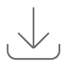 | `download`<br>附件下载 | 「导入备份」行 | 拿进来 | `square.and.arrow.down` |  |
|  | `externaldrive`<br>移动存储设备 | 「照片与录音占用」行 | 存储 | `internaldrive` |  |
|  | `clean`<br>清理加速 | 「清理 N 个残留文件」行 | 清理 | `sparkles` | 有残留文件才出现 |
|  | `exclamationmark_triangle`<br>内容举报/感叹号 | 导出页 / 导入页里的警告 | 警告 | `exclamationmark.triangle` |  |
|  | `checkmark_square_fill`<br>已选/钩/勾选 | 导出页「我已了解…」勾上 | 勾选 | `checkmark.square.fill` |  |
|  | `square`<br>方形 | 导出页「我已了解…」没勾 | 未勾 | `square` |  |

### 设置 → 写作统计 / 关于

| 预览 | 鸿蒙 `sys.symbol.` | 位置 | 意思 | iOS | 备注 |
|---|---|---|---|---|---|
|  | `chevron_left`<br>返回/向左 | 写作统计：日历往前翻一个月；左上角返回 | 往前 | `chevron.left` |  |
|  | `chevron_right`<br>下一步/向右 | 写作统计：日历往后翻一个月；情绪小结「往期小结 >」 | 往后 | `chevron.right` |  |
|  | `info_shield`<br>隐私声明 | 关于：「隐私政策」行 | 隐私 | `lock.shield` | 官方中文名就叫「隐私声明」 |
|  | `doc_text`<br>日志/文本/文件 | 关于：「用户协议」行 | 文档 | `doc.text` |  |
|  | `info_circle`<br>模式详情 | 关于：「版本」行 | 信息 | `info.circle` |  |

### 设置 → 账户、注销账号

| 预览 | 鸿蒙 `sys.symbol.` | 位置 | 意思 | iOS | 备注 |
|---|---|---|---|---|---|
|  | `rename`<br>重命名 | 「昵称」行 | 签名 | `signature` |  |
|  | `phone`<br>通话音量/电话 | 「手机号」行（绑过） | 手机 | `iphone` |  |
|  | `exclamationmark_triangle`<br>内容举报/感叹号 | 「绑定手机号」行（没绑，红字「未绑定」） | 警告 | `exclamationmark.triangle` |  |
| — | （鸿蒙没有这一处） | 「Apple ID」/「绑定 Apple ID」行 | 苹果 | `applelogo` | 鸿蒙没有这两行；华为账号的行见 U02 |
|  | `arrow_right_to_line`<br>（图标库网页没列，字体里有，DevEco 里核对） | 「退出登录」行 | 离开 | `rectangle.portrait.and.arrow.right` |  |
|  | `person_xmark`<br>（图标库网页没列，字体里有，DevEco 里核对） | 「注销账号」行（红色） | 删人 | `person.crop.circle.badge.xmark` |  |
|  | `trash`<br>删除/垃圾箱/回收站 | 注销页第一步：会删掉什么 | 删除 | `trash` |  |
|  | `ebook`<br>电子书 | 注销页第一步：日记不受影响 | 书 | `book.closed` |  |
|  | `arrowshape_turn_up_left`<br>回复 | 注销页第一步：不能撤回 | 回头 | `arrow.uturn.backward` |  |

### 尺素会员（付费页、会员页）

| 预览 | 鸿蒙 `sys.symbol.` | 位置 | 意思 | iOS | 备注 |
|---|---|---|---|---|---|
|  | `xmark`<br>退出/关闭/取消/colse | 付费页左上角关闭 | 关闭 | `xmark` |  |
|  | `envelope_open`<br>打开邮件 | 权益：每周 20 张邮票 | 拆开的信 | `envelope.open` |  |
|  | `seal`<br>（图标库网页没列，字体里有，DevEco 里核对） | 权益：火漆封口的信 | 印章 | `seal` | 图标本身不是火漆印；页顶那枚大火漆印是图片，见第一节 |
|  | `worldclock`<br>语言切换 | 权益：今雨与雅故 | 地球 | `globe` | 官方中文名「语言切换」，画的是地球 |
|  | `point_bottomleft_forward_to_point_topright_scurvepath`<br>（图标库网页没列，字体里有，DevEco 里核对） | 权益：情绪小结 | 折线图 | `chart.xyaxis.line` | 一条起伏的走势线 |
|  | `picture`<br>图片 | 权益：全部相纸与封面版式 | 照片 | `photo.on.rectangle` |  |
|  | `ebook`<br>电子书 | 权益：印成一本书 | 书 | `book.closed` |  |
|  | `checkmark_circle_fill`<br>口算批改/钩/勾选 | 方案（年付 / 月付）选中 | 已选 | `checkmark.circle.fill` |  |
|  | `circle`<br>工具箱 | 方案没选中 | 空圈 | `circle` |  |

### 写日记、编辑、此时此地

| 预览 | 鸿蒙 `sys.symbol.` | 位置 | 意思 | iOS | 备注 |
|---|---|---|---|---|---|
|  | `chevron_left`<br>返回/向左 | 写日记左上角返回（退出 ≠ 丢弃，见 v1） | 返回 | `chevron.left` |  |
|  | `checkmark`<br>确认/钩/勾选 | 写日记 / 编辑右上角完成 | 完成 | `checkmark` |  |
|  | `xmark`<br>退出/关闭/取消/colse | 编辑页关闭；选日记本页关闭 | 关闭 | `xmark` |  |
|  | `camera`<br>拍照 | 工具栏：拍照 | 相机 | `camera` |  |
|  | `picture`<br>图片 | 工具栏：从相册插照片 | 照片 | `photo` |  |
|  | `mic`<br>语音/话筒/麦克风 | 工具栏：录音（一篇最多 3 段，满了变淡点不动） | 麦克风 | `mic` |  |
| 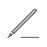 | `pencil_line_1`<br>高亮色 | 空白页的提示笔 | 笔 | `pencil.line` |  |
|  | `local`<br>位置/定位 | 「此时此地」按钮（开着记录位置时） | 定位 | `location` |  |
|  | `thermometer_medium`<br>（图标库网页没列，字体里有，DevEco 里核对） | 「此时此地」按钮（关了记录位置，只取天气） | 温度计 | `thermometer.medium` |  |
| 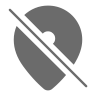 | `local_slash_fill`<br>禁用GPS/关闭 | 地点：不显示位置 / 没取到 | 不定位 | `location.slash` |  |
|  | `chevron_down`<br>向下 | 地点右边：点开换地点 | 展开 | `chevron.down` |  |
|  | `arrow_clockwise`<br>邮件刷新 | 天气没取到：重试 | 重试 | `arrow.clockwise` |  |
|  | `local_fill`<br>定位/位置 | 此时此地标记里，地名前的小定位 | 定位 | `location.fill` | 日记卡片、详情页同一个标记 |
|  | `checkmark`<br>确认/钩/勾选 | 换地点的弹窗：当前选中的地点 | 已选 | `checkmark` |  |
|  | `bold`<br>加粗 | 正文工具条：加粗 | 加粗 | `bold` |  |
| 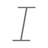 | `italic`<br>（图标库网页没列，字体里有，DevEco 里核对） | 正文工具条：斜体 | 斜体 | `italic` |  |
|  | `textformat_size_square`<br>字体大小/识别文字 | 正文工具条：小标题 | 字号 | `textformat.size` |  |
|  | `pencil_line_1`<br>高亮色 | 正文工具条 / 选中文字菜单：荧光笔 | 荧光笔 | `highlighter` | 官方中文名「高亮色」 |
|  | `strikethrough`<br>（图标库网页没列，字体里有，DevEco 里核对） | 选中文字菜单：删除线 | 删除线 | `strikethrough` |  |
|  | `arrow_left`<br>返回 | 长按照片菜单：移到左边 | 往左 | `arrow.left` |  |
|  | `arrow_right`<br>箭头/向右 | 长按照片菜单：移到右边 | 往右 | `arrow.right` |  |
|  | `star`<br>获赞与收藏/五角 | 长按照片菜单：设为封面（大屏模式） | 星 | `star` |  |
|  | `star_slash`<br>取消收藏 | 长按照片菜单：取消封面 | 取消星 | `star.slash` |  |
|  | `picture_2`<br>从图库中选择 | 长按照片菜单：换相纸 | 相框 | `photo.artframe` |  |
|  | `trash`<br>删除/垃圾箱/回收站 | 长按照片菜单：删除 | 删除 | `trash` |  |
|  | `cut`<br>截取/剪刀 | 正文里照片剪下来的小剪刀标 | 剪刀 | `scissors` |  |
|  | `play_fill`<br>播放 | 录音卡片：播放 | 播放 | `play.fill` | 大屏卡片的录音也一样 |
|  | `pause`<br>暂停 | 录音卡片：暂停 | 暂停 | `pause.fill` |  |
|  | `xmark_circle_fill`<br>取消/关闭/退出/colse | 录音卡片：去掉这段录音 | 去掉 | `xmark.circle.fill` |  |

### 尺素相机

| 预览 | 鸿蒙 `sys.symbol.` | 位置 | 意思 | iOS | 备注 |
|---|---|---|---|---|---|
|  | `xmark`<br>退出/关闭/取消/colse | 左上角关闭 | 关闭 | `xmark` |  |
|  | `arrow_2_circlepath`<br>旋转、切换 | 切换前后镜头 | 翻转 | `arrow.triangle.2.circlepath` |  |
| 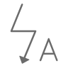 | `camera_flash_auto`<br>（图标库网页没列，字体里有，DevEco 里核对） | 闪光灯：自动 | 闪光自动 | `bolt.badge.a` |  |
| 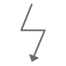 | `camera_flash`<br>（图标库网页没列，字体里有，DevEco 里核对） | 闪光灯：开 | 闪光开 | `bolt.fill` |  |
|  | `camera_flash_slash`<br>（图标库网页没列，字体里有，DevEco 里核对） | 闪光灯：关 | 闪光关 | `bolt.slash` |  |
|  | `rectangle_on_rectangle`<br>相册 | 选相纸 | 一叠 | `square.stack` |  |
|  | `chevron_up`<br>向上 | 相纸列表展开 | 展开 | `chevron.up` |  |
|  | `camera`<br>拍照 | 取景框没起来时的占位 | 相机 | `camera` |  |
|  | `camera_slash_fill`<br>禁用相机/关闭 | 没有相机权限时 | 相机不可用 | `camera.badge.ellipsis` |  |

### 记录页、日记本、详情

| 预览 | 鸿蒙 `sys.symbol.` | 位置 | 意思 | iOS | 备注 |
|---|---|---|---|---|---|
|  | `plus`<br>增加/添加 | 记录页右上角写日记；日记本页新建；选日记本时新建 | 加 | `plus` |  |
|  | `chevron_right`<br>下一步/向右 | 列表「按月份」那张卡片 | 进入 | `chevron.right` |  |
|  | `more`<br>更多 | 日记本右上角「…」；照片全屏右上角「…」 | 更多 | `ellipsis` |  |
|  | `paintbrush`<br>画笔 | 日记本「…」：编辑封面 | 画笔 | `paintbrush` |  |
|  | `rename`<br>重命名 | 日记本「…」：重命名；详情页编辑 | 笔 | `pencil` |  |
|  | `ebook`<br>电子书 | 日记本「…」：精装 PDF | 书 | `book.closed` |  |
|  | `trash`<br>删除/垃圾箱/回收站 | 日记本「…」：删除；详情页删除 | 删除 | `trash` |  |
|  | `list_bullet`<br>项目符号-圆点 | 日记本里：列表排法 | 列表 | `list.bullet` |  |
|  | `square_grid_2x2`<br>检测项_应用 | 日记本里：格子排法 | 格子 | `square.grid.3x3` |  |
|  | `square_and_pencil`<br>编辑 | 日记本里：在这本里写一篇 | 写 | `square.and.pencil` |  |
|  | `picture`<br>图片 | 编辑封面：还没有照片时 | 照片 | `photo.on.rectangle.angled` |  |
|  | `picture`<br>图片 | 编辑封面：更换照片 | 照片 | `photo` |  |
| 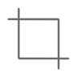 | `crop`<br>裁剪 | 编辑封面：调整构图 | 裁切 | `crop` |  |
|  | `xmark_circle`<br>关闭/退出/取消/colse | 编辑封面：移除照片 | 去掉 | `xmark.circle` |  |
|  | `arrow_left_arrow_right`<br>（图标库网页没列，字体里有，DevEco 里核对） | 照片全屏「…」：移到左侧 / 右侧 | 左右换 | `arrow.left.arrow.right` |  |
|  | `rectangle_on_rectangle`<br>相册 | 照片全屏「…」：更换相纸样式 | 换一张 | `square.on.square` |  |
|  | `chevron_left`<br>返回/向左 | 阅读器、心情页左上角返回 | 返回 | `chevron.left` |  |

### 精装 PDF

| 预览 | 鸿蒙 `sys.symbol.` | 位置 | 意思 | iOS | 备注 |
|---|---|---|---|---|---|
|  | `xmark`<br>退出/关闭/取消/colse | 导出页关闭 | 关闭 | `xmark` |  |
|  | `share`<br>分享 | 导出页：分享 PDF | 分享 | `square.and.arrow.up` |  |
|  | `printer`<br>（图标库网页没列，字体里有，DevEco 里核对） | 导出页：怎么打印 | 打印机 | `printer` |  |
|  | `doc_text`<br>日志/文本/文件 | 打印说明：A5 大小 | 文档 | `doc.text` |  |
|  | `rectangle_on_rectangle`<br>相册 | 打印说明：单面也能装订 | 两张纸 | `doc.on.doc` |  |
|  | `books_vertical_fill`<br>（图标库网页没列，字体里有，DevEco 里核对） | 打印说明：做成一本真正的书 | 书 | `books.vertical` |  |
|  | `waveform`<br>（图标库网页没列，字体里有，DevEco 里核对） | PDF 正文里「一段录音」的标记 | 声波 | `waveform` | 画在 PDF 里，鸿蒙自己的 PDF 用同一个意思 |

### 邮筒、信箱、世界笔友

| 预览 | 鸿蒙 `sys.symbol.` | 位置 | 意思 | iOS | 备注 |
|---|---|---|---|---|---|
|  | `inbox`<br>（图标库网页没列，字体里有，DevEco 里核对） | 邮筒页：信箱 | 收件匣 | `tray` |  |
|  | `worldclock`<br>语言切换 | 邮筒页：按所在经度显示的地球（亚洲 / 大洋洲） | 地球 | `globe.asia.australia` | 鸿蒙没有分区域的地球，一律用这个 |
|  | `worldclock`<br>语言切换 | 同上（欧洲 / 非洲） | 地球 | `globe.europe.africa` |  |
|  | `worldclock`<br>语言切换 | 同上（美洲） | 地球 | `globe.americas` |  |
|  | `plus_circle`<br>附件区/添加/增加 | 投信那叠信：再加一封 | 加 | `plus.circle` |  |
|  | `arrow_left_arrow_right`<br>（图标库网页没列，字体里有，DevEco 里核对） | 信件详情：翻面看译文 / 原文 | 翻面 | `arrow.left.arrow.right` | 和 iOS 一样用左右箭头 |
|  | `chevron_right`<br>下一步/向右 | 信箱分组行、求助卡片 | 进入 | `chevron.right` |  |
|  | `envelope`<br>消息/邮件 | 笔友名片：写信给 TA | 信 | `envelope` |  |
|  | `sun_max`<br>曝光/亮度 | 笔友名片：对方那边是白天 | 太阳 | `sun.max` |  |
|  | `moon`<br>免打扰/月亮 | 笔友名片：对方那边是夜里 | 月亮 | `moon` |  |
|  | `checkmark`<br>确认/钩/勾选 | 笔友名片：已选为收件人 | 已选 | `checkmark` |  |
|  | `location_up`<br>导航 | 世界地图：回到我的位置 | 定位 | `location` |  |
|  | `envelope_fill`<br>邮件/消息 | 世界地图：在路上的信 | 信 | `envelope.fill` |  |
|  | `worldclock`<br>语言切换 | 求助卡片：网站 | 地球 | `globe` |  |
|  | `phone`<br>通话音量/电话 | 求助卡片：电话 | 电话 | `phone` |  |

---

## 三、天气图标（此时此地、日记卡片、详情页）

日记里存的天气标识 `weatherCode` 是苹果天气给的 SF Symbols 名（`sun.max`、`cloud.sun.rain`、`moon.stars` …；旧日记是 `clear` / `rain` 这类代码）—— 见 v1 `05_DATA_MODEL.md`、Q7。
鸿蒙**显示**时按下表：从上往下看名字里含不含左边的词，**先匹配的先用**（`cloud.bolt.rain` 先碰到 bolt → 雷阵雨）；一个都不含的显示 `cloud`。
鸿蒙自己**写**天气时，写成 iOS 认得的名字（就用表里「意思」对应的那个 SF Symbols 名，如晴天白天写 `sun.max`、小雨写 `cloud.drizzle`）—— iOS 读到不认识的名字会退成一朵云，不会出错。

| 预览 | 名字里含 | 意思 | 鸿蒙 `sys.symbol.` |
|---|---|---|---|
|  | `bolt / thunder` | 雷阵雨、雷暴 | `thunderstorm`<br>（图标库网页没列，字体里有，DevEco 里核对） |
|  | `tornado` | 龙卷风 | `tornado`<br>（图标库网页没列，字体里有，DevEco 里核对） |
|  | `hurricane / tropicalstorm` | 台风、热带风暴 | `typhoon`<br>（图标库网页没列，字体里有，DevEco 里核对） |
| 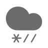 | `sleet` | 雨夹雪 | `sleet`<br>（图标库网页没列，字体里有，DevEco 里核对） |
|  | `hail` | 冰雹 | `hail`<br>（图标库网页没列，字体里有，DevEco 里核对） |
|  | `snow` | 雪 | `moderatesnow`<br>（图标库网页没列，字体里有，DevEco 里核对） |
|  | `heavyrain` | 大雨 | `heavy_rain`<br>（图标库网页没列，字体里有，DevEco 里核对） |
|  | `drizzle` | 毛毛雨 | `light_rain`<br>（图标库网页没列，字体里有，DevEco 里核对） |
|  | `rain` | 雨 | `moderate_rain`<br>（图标库网页没列，字体里有，DevEco 里核对） |
|  | `fog` | 雾 | `foggy`<br>（图标库网页没列，字体里有，DevEco 里核对） |
|  | `smoke` | 烟 | `smoke_fill`<br>（图标库网页没列，字体里有，DevEco 里核对） |
|  | `dust` | 浮尘、沙尘 | `dust_storm`<br>（图标库网页没列，字体里有，DevEco 里核对） |
| 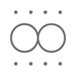 | `haze` | 霾 | `haze`<br>（图标库网页没列，字体里有，DevEco 里核对） |
|  | `wind` | 大风 | `wind`<br>（图标库网页没列，字体里有，DevEco 里核对） |
|  | `thermometer.sun / hot` | 酷热 | `thermometer_sun_fill`<br>（图标库网页没列，字体里有，DevEco 里核对） |
|  | `thermometer.snowflake / frigid` | 严寒 | `thermometer_snowflake`<br>（图标库网页没列，字体里有，DevEco 里核对） |
|  | `cloud.sun` | 少云（白天） | `cloud_sun_fill`<br>（图标库网页没列，字体里有，DevEco 里核对） |
| 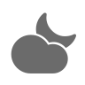 | `cloud.moon` | 少云（夜里） | `cloud_moon_fill`<br>（图标库网页没列，字体里有，DevEco 里核对） |
|  | `cloud` | 多云、阴 | `cloud`<br>（图标库网页没列，字体里有，DevEco 里核对） |
|  | `moon` | 晴（夜里） | `moon`<br>免打扰/月亮 |
|  | `sun / clear` | 晴（白天） | `sun_max`<br>曝光/亮度 |

天气图标颜色跟着所在那一行字的颜色（iOS 是次要文字色），大小比那一行的字小一号；地名前的小定位比天气图标再小 1。

---

## 四、以后改了怎么办

iOS 侧改 `Scripts/make_harmony_icon_catalog.py` 里的表（或改了 `WaxSeal.swift`）后重跑，整个 `icons/` 目录重出；鸿蒙按新表换 `sys.symbol` 名、整批替换 `wax_seal/` 的图。**不要在鸿蒙这边手改图。**
