# 设置各页详解 · 鸿蒙对照

> 2026-11-07 iOS 侧写，对应更新包 **U19**（随 U19 交付、冻结；以后有变化写进新的更新包）。
> 这份按**页面**写：每一页从哪进、**怎么弹出来、弹在哪**、从上到下每一行是什么、右边显示什么、点了怎样、存在哪、默认值多少。
> 图标按「图标」列全 App 的总表在 `../icons/ICONS.md`；首页的排版、配色、行首图标图片已在 **U10** 交付（`../settings_icons/GUIDE.md`），这里只补首页每一行点了去哪。

---

## 先读这五条

1. **截图只看排版、位置和弹出方式**。`screenshots/` 是 iOS 模拟器上素笺主题、简体中文截的（2 倍图）。
   🔴 **不要从截图上抠图标**：截图里二级页的小图标是苹果的 SF Symbols，不许用到鸿蒙上（见 `../icons/ICONS.md` 第 2 条）。每一行该用哪个鸿蒙图标，就写在那一行（小预览图 + `sys.symbol.` 名）
2. **图标两种来源**：设置**首页**行首是尺素自己画的线条 → 用 U10 给的图片；**二级页及以下**全部用鸿蒙系统的 **HarmonyOS Symbol**（`SymbolGlyph($r('sys.symbol.xxx'))`）。火漆印用图片（`../icons/wax_seal/`）
3. **文案**：这里写的是简体中文，也就是 iOS `Localizable.xcstrings` 的 key，七种语言的译文都在 iOS 快照的 xcstrings 里，按 key 取，不要自己翻
4. **存储**：「存哪」一列是本机偏好的 key（v1 `05_DATA_MODEL.md` §9 那张表）。默认值以这里为准 —— 后来的包改过几个（U07 把 `homeDisplayMode` 改成默认大屏、U11 删掉「青鸟」默认名）
5. 标着 **「鸿蒙不做」** 的是 v1 Q10 说的死设置（iOS 页面上有、但没有任何地方读它），列出来只是为了和截图对得上

---

## 一、页面地图

```
设置（一级页，大标题）
├─ 账户卡
│   ├─ 没登录 ───────────── 登录页（半屏弹窗）
│   └─ 已登录 ───────────── 账户（推入）
│        ├─ 昵称 ──────────── 屏幕中间的输入弹窗
│        ├─ 绑定手机号 / 手机号 ── 半屏弹窗
│        ├─ 退出登录 ────────── 底部确认
│        └─ 注销账号 ────────── 半屏弹窗（几步）
├─ 尺素会员
│   ├─ 没开通 ───────────── 付费页（全屏盖上来）
│   └─ 已开通 ───────────── 会员页（推入）→ 管理订阅（系统页）
├─ 外观（推入）
│   ├─ 主题选择（推入）──── 点一套 → 主题介绍（半屏弹窗，能拉到全屏）
│   ├─ 应用图标（推入）
│   ├─ 启动动画 / 搜索日记（开关）
│   └─ 手记页（行尾的小菜单：大屏 / 列表）
├─ 日记（推入）
│   ├─ 照片相纸样式（推入）── 点会员款 → 付费页（全屏）
│   ├─ 封条提醒天数（行尾的小菜单）← 鸿蒙不做
│   └─ 提醒写日记（开关）→ 时间（行尾的小气泡，里面是滚轮）、重复（七个圆）
├─ 笔友（推入）── 笔友名（行内直接输入）
├─ 位置与天气（推入）
│   ├─ 记录位置（开关）
│   └─ 位置精度（行尾的小菜单：市 / 区县 / 街道）
├─ 语言（推入，直接就是选择页）
├─ 数据与备份（推入）
│   ├─ 导出备份 ─────────── 半屏弹窗
│   ├─ 导入备份 ─────────── 系统文件选择器 → 选好后半屏弹窗（导入页）→ 有同名日记本时屏幕中间弹窗
│   └─ 清理残留文件 ──────── 底部确认
├─ 写作统计（推入，内容页）
├─ 给我们评分 ─────────── 跳应用市场
├─ 反馈与建议 ─────────── 跳邮件 App（没有邮件 App：复制地址 + 顶部提示条）
├─ 关于（推入）── 隐私政策 / 用户协议（推入）
└─ 关注我们 ×3 ────────── 跳各平台（U10）
```

「此时此地」（天气 + 地点）不在设置里显示，但它的规则由「位置与天气」这一页决定，写在第十二节。

---

## 二、弹出方式对照

同一种弹出方式全 App 只用一种做法。**照表用，不要换**：比如行尾的小菜单不要改成推入一页，确认删除不要改成顶部提示条。

| 叫法 | iOS 写法 | 长什么样、出现在哪 | 鸿蒙用 |
|---|---|---|---|
| **推入** | `NavigationLink` | 新页从右边推进来，左上角圆形返回钮，顶上居中一行小标题 | `Navigation` + `NavDestination` |
| **半屏弹窗** | `.sheet` | 从屏幕底部升起，几乎占满，顶上露出一窄条下面那页（变暗），圆角；**往下拖能关** | `bindSheet`（高度 `SheetSize.LARGE`）；主题介绍那个是两档 `[MEDIUM, LARGE]`、带拖动条 |
| **全屏盖** | `.fullScreenCover` | 整屏从底部盖上来，**往下拖关不掉**，只能点左上角 × | `bindContentCover` |
| **行尾小菜单** | `Picker`（菜单样式） | 行尾显示当前值 + 上下小箭头；点它在**值的左下方**弹出一个圆角小菜单，当前那项前面打勾；点菜单外面收起 | `Select`，或 `bindMenu` 锚在行尾的值上 |
| **小气泡（时间）** | `DatePicker`（紧凑样式） | 行尾一个灰底圆角胶囊显示「21:00」；点它在**胶囊下方**弹出一张小卡片，里面是时、分两列滚轮，点外面收起 | `bindPopup` 锚在胶囊上，里面放 `TimePicker` |
| **屏幕中间的输入弹窗** | `.alert` + 输入框 | 屏幕正中，标题 + 一行说明 + 一个输入框 + 「取消」「保存」 | `CustomDialog`（`AlertDialog` 放不了输入框） |
| **屏幕中间的弹窗** | `.alert` | 屏幕正中，标题 + 说明 + 几个按钮竖着排，最后一个「取消」 | `AlertDialog` |
| **底部确认** | `.confirmationDialog` | 从屏幕底部弹出：顶上一行灰色说明，下面按钮，危险的那个是红字，最下面单独一个「取消」 | `ActionSheet` |
| **系统文件选择器** | `.fileImporter` | 系统「文件」 | `DocumentViewPicker` |
| **系统分享** | `ShareLink` | 系统分享面板 | Share Kit 的系统分享 |
| **跳系统设置** | `openSettingsURLString` | 跳到系统设置里尺素自己那一页 | 拉起系统设置的应用详情页 |
| **顶部提示条** | `AppEnvironment.errors` | 顶上滑下来一条，几秒后自己收（v1 `03_USER_FLOWS.md` 的 ErrorPresenter） | v1 已有的那个组件 |

---

## 三、二级页的样子（所有二级页通用）

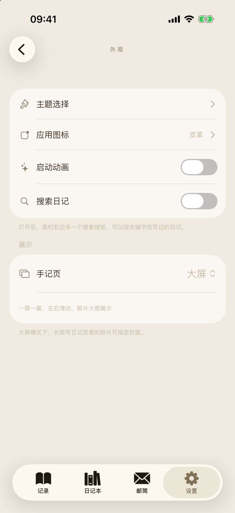

- **顶上**：左上角圆形返回钮；正中一行**小标题**（主题的小号字、字距拉宽、次要文字色），**不是大标题**
- **页面底色 / 卡片底色**：U10 的 R-SETTINGS-08（页面底比卡片深一档）。设置下面所有页面都用这一组，**写作统计除外**
- **分组卡片**：圆角卡片一组一组排，组与组之间留空；组下面可以有一段灰色小字（footer），组上面可以有一行灰色小标题（header）
- **一行**：
  - 行首图标：**HarmonyOS Symbol 14vp**（和 iOS 同号），次要文字色；图标占 20vp 宽，和文字间距 10vp。**不套框**（套框的只有首页）
  - 行名：主题的正文字、主文字色
  - 右边：要么是**当前值**（主题的小号字、第三级文字色），要么是开关（打开时是主题强调色），要么是 `>`（`sys.symbol.chevron_right`，第三级文字色）
  - 一行说明文字（比如「只记到城市，如「广州市」」）是**卡片里单独的一行**，小号字、第三级文字色，跟着上面那个选项变
- **点了是动作、不是进页面的行**（导出备份、导入备份）右边也是 `>`；跳到别的 App 的（首页的评分、反馈、关注我们）右边是 ↗（`sys.symbol.arrow_right_up_and_square`）

> 下面每一页的表格里，「图标」一列的小图是**鸿蒙图标的预览**（拿鸿蒙官方字体画的），不是 iOS 的图标。

---

## 四、设置首页

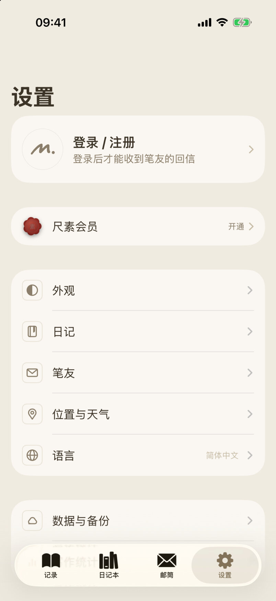 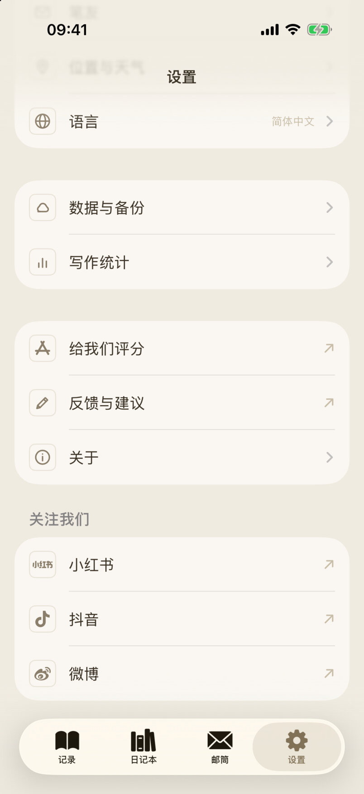

排版、配色、行首图标、大标题颜色、「关注我们」全在 **U10**（已交付）。这里只写每一行点了去哪：

| 图标 | 行 | 右边 | 点了 |
|---|---|---|---|
|  | 账户卡（没登录）：「登录 / 注册」+ 小字「登录后才能收到笔友的回信」 | `>` | **登录页，半屏弹窗**（第五节） |
|  | 账户卡（已登录）：昵称（没设昵称显示打了码的手机号）+ 小字「账号、手机号与登录方式」 | `>` | **账户页，推入**（第五节） |
| — | 已登录但**没绑手机号**：卡里多一行「还没有绑定手机号」，右边一个红底白字的「1」；卡下面一段红字「未绑定手机号。手机号是账号的唯一凭据，……」 | `>` | 也是推入账户页。🔴 这个提醒必须留在首页（v1 R-ACCOUNT，2026-08-12 账号分裂事故的对策） |
|  | 尺素会员（火漆印 26vp，压昵称首字，不套框、占 30vp 宽） | 没开通：强调色「开通」+ `>`；开通了：「有效期至 2027年11月7日」（日期跟 App 语言） | 没开通 → **付费页，全屏盖**；开通了 → **会员页，推入**（第十一节） |
|  | 外观 | `>` | 推入（第六节） |
|  | 日记 | `>` | 推入（第七节） |
|  | 笔友 | `>` | 推入（第八节） |
|  | 位置与天气 | `>` | 推入（第九节） |
|  | 语言 | 当前语言用**它自己的文字**写（简体中文 / English / 日本語…）+ `>` | 推入，直接是选择页（第十节） |
|  | 数据与备份 | `>` | 推入（第十三节） |
|  | 写作统计 | `>` | 推入（第十四节） |
|  | 给我们评分 | ↗ | 直接跳应用市场的评论页，不用系统评分弹窗（v1 R-SETTINGS-04） |
|  | 反馈与建议 | ↗ | 打开手机的邮件 App 写一封新邮件：收件人 `connect@sinaratech.com.cn`，主题「反馈与建议」（跟 App 语言），正文先空三行给用户写，下面一行「——」，再下面一行设备信息（鸿蒙写成 `Memoir 1.0 (4) · HarmonyOS 5.1 · 机型`，不翻译）。**不带日记内容、不带日志**。手机上没有能写邮件的 App → 把地址复制到剪贴板 + 顶部提示条「邮箱地址已复制：connect@sinaratech.com.cn」（成功样式）—— 不许点了没反应 |
|  | 关于 | `>` | 推入（第十五节） |
|    | 关注我们：小红书 / 抖音 / 微博 | ↗ | U10 R-SETTINGS-07 |

另外两件首页的事：

- **每次打开设置页**，已登录的话后台悄悄问一次服务端「我是谁」（`GET /me`），把绑定状态更新成最新的；服务端说 `unauthorized`（登录过期）或 `not_found`（账号没了）→ 直接退出登录；其他失败（没网）不吭声，用本机存的
- 桌面长按图标的快捷菜单「应用图标」→ 直接推入「应用图标」页，跳过外观那一层（v1 R-THEME-08）

---

## 五、账户（登录、账户页、昵称、手机号、退出、注销）

### 登录页（没登录时点账户卡）

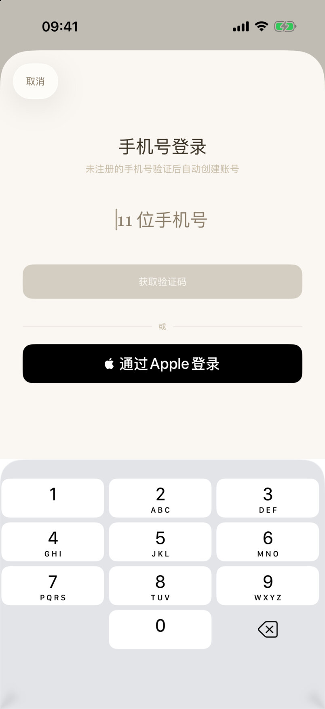

- **半屏弹窗**，左上角「取消」，弹出来**输入框自动拿到焦点、数字键盘弹起**
- 标题「手机号登录」+ 小字「未注册的手机号验证后自动创建账号」→ 输入框「11 位手机号」→「获取验证码」（手机号不够 11 位时是灰的）→ 一条细线中间一个「或」→ 黑底「通过 Apple 登录」
- 第二步换成「输入验证码」+「6 位验证码」，下面「重新发送（59s）」倒计时，到 0 变成强调色「重新发送」
- 🟢 **鸿蒙**：「通过 Apple 登录」换成华为账号登录，按 **U02**（已交付）。短信登录、倒计时、错误码照 v1 R-ACCOUNT

### 账户页（已登录时点账户卡，推入）

截图需要真账号，没截；照下面的行做。

| 图标 | 鸿蒙 `sys.symbol.` | 行 | 右边 | 点了 |
|---|---|---|---|---|
|  | `rename` | 昵称 | 昵称，没设显示「未设置」+ `>` | **屏幕中间的输入弹窗**：标题「昵称」，说明「笔友写信时会这样称呼你。留空则不设置。」，输入框占位「给自己起个名字」，按钮「取消」「保存」。保存 → `PATCH /me` 的 `displayName`（去掉首尾空白，空的就是清掉）；失败 → 顶部提示条「昵称保存失败」 |
|  | `exclamationmark_triangle` | 绑定手机号（**没绑时**才有这一行） | 红字「未绑定」+ `>` | **半屏弹窗**：就是登录页换成「绑定手机号」模式（标题「绑定手机号」、小字「绑定后可在任何设备用手机号登录此账号」）。这一行下面卡片里一行红字「手机号是账号的唯一凭据。……」 |
|  | `phone` | 手机号（**绑过**才是这一行） | 打码的手机号 + `>` | **半屏弹窗**：换手机号（v1 R-ACCOUNT） |
| — | — | Apple ID / 绑定 Apple ID | — | 🟢 **鸿蒙没有这两行**，换成华为账号的绑定行，按 U02 |
|  | `arrow_right_to_line` | 退出登录（单独一组） | — | **底部确认**：说明「退出登录后，AI 来信等云端能力将不可用，本地日记不受影响。」+ 红字「退出登录」+「取消」 |
|  | `person_xmark` | 注销账号（再单独一组，**图标和字都是红色**） | — | **半屏弹窗**：注销流程照 v1 R-ACCOUNT-07。这一组下面的小字「注销只删除我们服务器上的账号和来信记录，你的日记不受影响。」 |

- 退出登录或注销成功后，这一页自己退回设置首页（不留一张空白页）

---

## 六、外观

 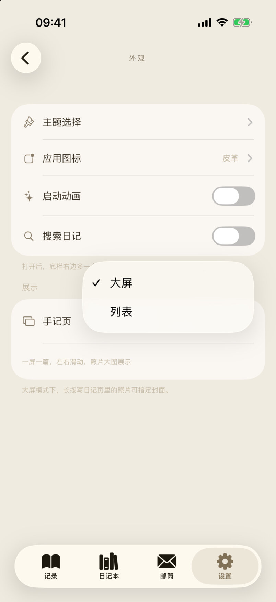

| 图标 | 鸿蒙 `sys.symbol.` | 行 | 右边 | 点了 | 存哪 · 默认 |
|---|---|---|---|---|---|
|  | `paintbrush` | 主题选择 | `>` | 推入主题选择页 | `selectedTheme` · `bamboo` |
|  | `square_grid_2x2` | 应用图标 | 「跟随主题」或那张图标的名字（素笺 / 皮革 / 肯特 / 极夜）+ `>` | 推入应用图标页 | `appIconSelection` · 空 = 跟随主题 |
|  | `wand_and_stars` | 启动动画 | 开关 | 关了打开 App 不放开场那一笔 m. | `showSplashAnimation` · 开 |
|  | `magnifyingglass` | 搜索日记 | 开关 | 打开后底栏右边多一颗搜索按钮 —— **按 U12（草稿），U12 交付前这一行先不做** | `showSearchTab` · 关 |

第一组下面的小字：「打开后，底栏右边多一个搜索按钮，可以按关键字找写过的日记。」（跟着「搜索日记」一起做）

第二组，组上面小标题「展示」：

| 图标 | 鸿蒙 `sys.symbol.` | 行 | 右边 | 点了 | 存哪 · 默认 |
|---|---|---|---|---|---|
|  /  | 当前是大屏：`rectangle_on_rectangle`；列表：`list_bullet`（**图标跟着当前选的换**） | 手记页 | 当前值「大屏」/「列表」+ 上下小箭头 | **行尾小菜单**（截图右）：大屏、列表两项，当前项打勾 | `homeDisplayMode` · `showcase`（U07） |
| — | — | （卡片里的一行说明，跟着选的变） | — | 大屏：「一屏一篇，左右滑动，照片大图展示」；列表：「一屏多条，便于翻找」 | — |

第二组下面的小字：「大屏模式下，长按写日记页里的照片可指定封面。」

### 主题选择（推入）

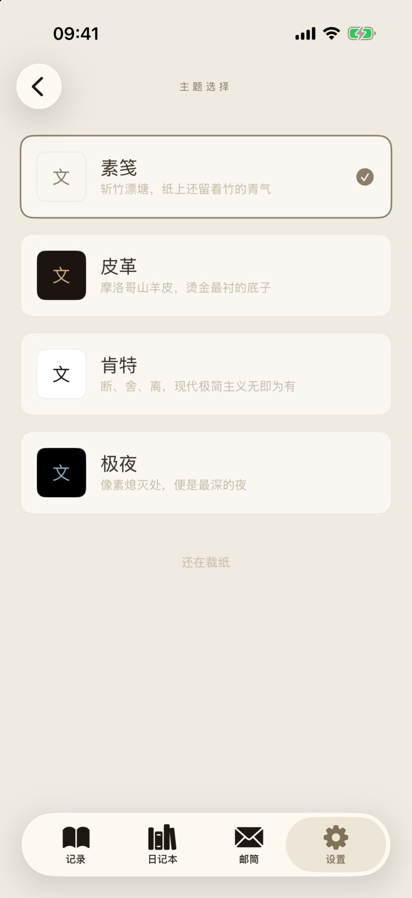 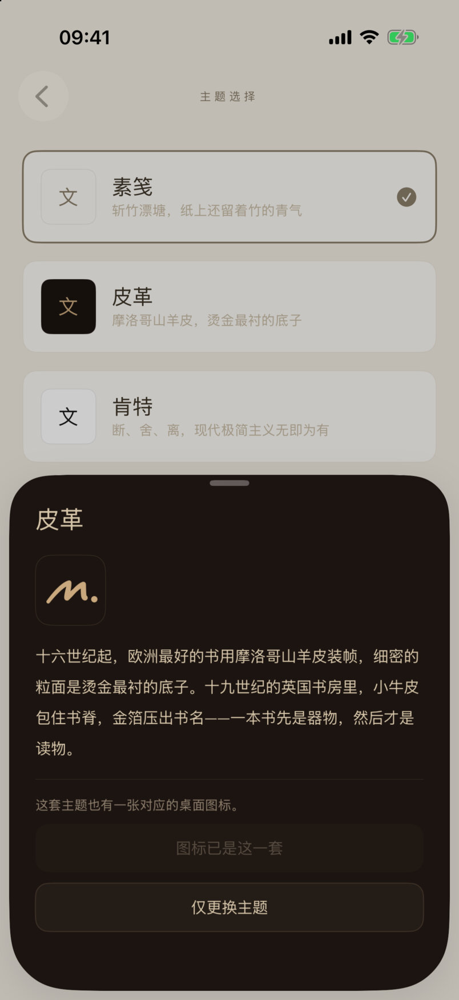

- 一张主题一张圆角卡片（四周留 20vp，卡片之间 16vp）：左边 48vp 的方块（这套主题的纸色底 + 墨色的「文」字，就是主题的两个色块）、主题名、一句讲纸的话（**最多两行、不截断**）；选中的那张描强调色边、右边  `checkmark_circle_fill`（强调色）
- 列表最下面一行灰字「还在裁纸」
- 点任何一张（包括已选中的）→ **主题介绍，半屏弹窗，两档高度**（先停在半屏，能往上拉到全屏，顶上有拖动条）。弹窗**用那套主题的配色画**，内容和按钮照 v1 R-THEME-04 ~ 06：主题名 → 64vp 的图标预览 → 纸史正文 →「出处」（默认收起；收起时字后面  `chevron_down`，展开后  `chevron_up`）→ 底部固定一栏：一条细线、「这套主题也有一张对应的桌面图标。」、主按钮「一并更换图标」（图标已经是这一套时变灰「图标已是这一套」）、次按钮「仅更换主题」
- 🔴 **先关弹窗、再换主题和图标**：换图标时系统会弹它自己的提示，叠在我们的弹窗上会出问题。往下拖关掉 = 什么都不换

### 应用图标（推入）

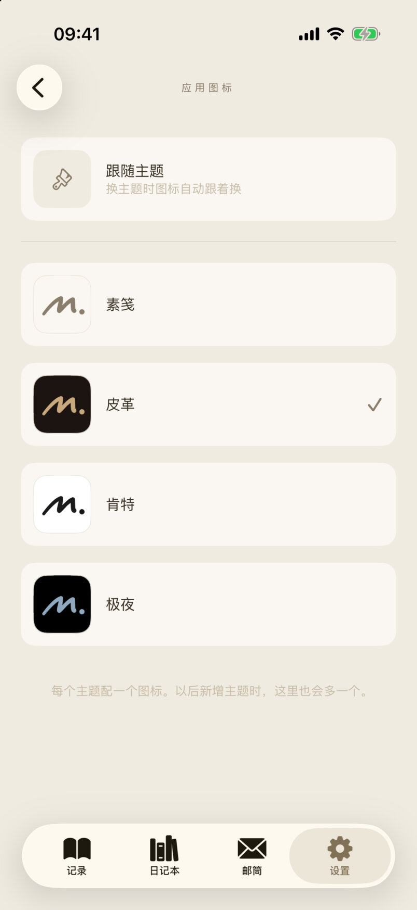

- 第一张卡片「跟随主题」：左边 56vp 圆角方块（主题的浅强调底色）里一个  `paintbrush`，右边两行「跟随主题」/「换主题时图标自动跟着换」
- 一条细线，下面四张卡片：56vp 的图标预览（描 0.5vp 主题边框色）+ 名字（素笺 / 皮革 / 肯特 / 极夜）
- 选中的那张右边  `checkmark`（强调色）
- 最下面灰字「每个主题配一个图标。以后新增主题时，这里也会多一个。」
- **点了立刻换**；换失败 → 顶部提示条「图标切换失败，请稍后再试」
- 鸿蒙怎么换桌面图标：v1 Q5（鸿蒙仓库已用 AGC 的做法做了）

---

## 七、日记

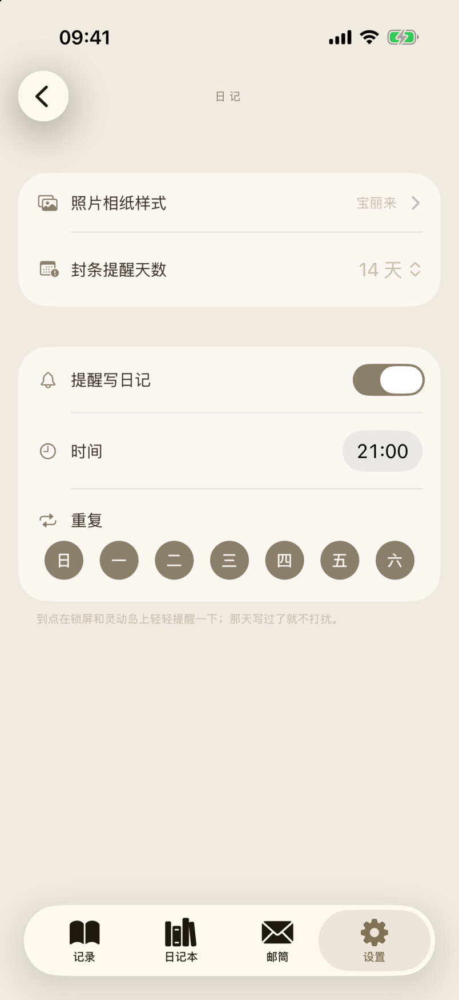 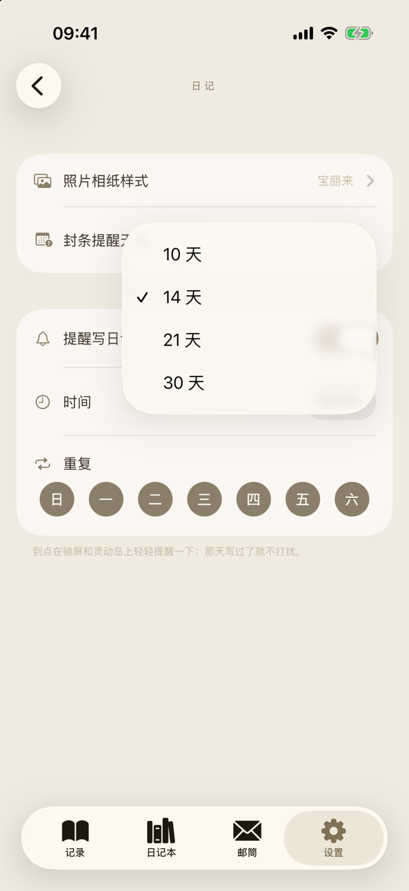 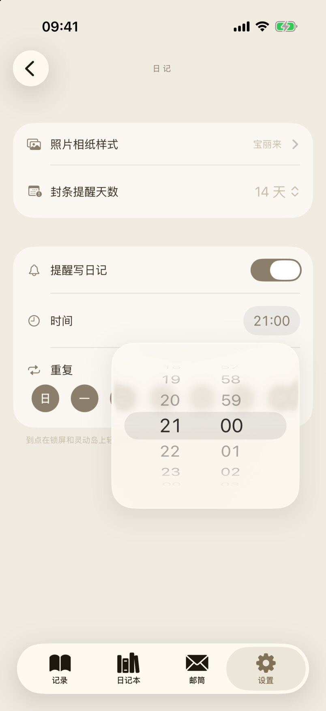

第一组：

| 图标 | 鸿蒙 `sys.symbol.` | 行 | 右边 | 点了 | 存哪 · 默认 |
|---|---|---|---|---|---|
|  | `picture` | 照片相纸样式 | **实际生效的**样式名（会员到期后存着的会员款显示成「宝丽来」）+ `>` | 推入照片相纸样式页 | `defaultPaperStyle` · `polaroid` |
|  | `calendar` | 封条提醒天数 | 「14 天」+ 上下小箭头 | 行尾小菜单：10 / 14 / 21 / 30 天（截图中） | `dormantDaysThreshold` · 14 —— 🔴 **鸿蒙不做**（v1 Q10） |

第二组「提醒写日记」—— **按 U18（草稿），U18 交付前这一组先不做**；做的时候长这样：

| 图标 | 鸿蒙 `sys.symbol.` | 行 | 右边 | 点了 | 存哪 · 默认 |
|---|---|---|---|---|---|
|  | `bell` | 提醒写日记 | 开关 | 打开的那一刻才问通知权限（U18 R-REMIND-02） | `writingReminderEnabled` · 关 |
|  | `clock` | 时间（开关开着才有） | 灰底圆角胶囊「21:00」（按 App 语言的时间格式） | **小气泡**（截图右）：胶囊下方弹出，时、分两列滚轮，滚完即存，点外面收起 | `writingReminderMinutes` · 1260（= 21:00，存「从零点起第几分钟」） |
|  | `repeat` | 重复（开关开着才有） | — | 行名下面一排七个 34vp 的圆：选中的实心强调色、字是纸色；没选的描一圈边框色。点一下选上 / 去掉，**至少留一天**（剩最后一天时点它没反应） | `writingReminderWeekdays` · `1234567`（1 = 周日 … 7 = 周六） |

- 七个圆**从这台手机设置的一周第一天开始排**；圆里的字是一个字的星期（日 一 二… / S M T…，跟 App 语言），读屏念完整的「星期一」
- 这一组下面的小字：
  - 通知权限被拒、开关又开着：先一行红字「通知没有打开，提醒发不出来。」+ 强调色「去设置」（跳系统设置）
  - 再一行：鸿蒙用「到点发一条通知提醒一下；那天写过了就不打扰。」（iOS 26 那句「锁屏和灵动岛」鸿蒙不用，见 U18）
- 每次进这一页重新查一次通知权限

### 照片相纸样式（推入）

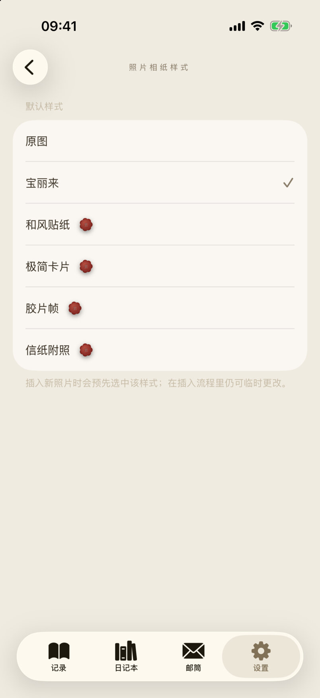

- 组上面小标题「默认样式」；六行：原图、宝丽来、和风贴纸、极简卡片、胶片帧、信纸附照
- 后四种是会员款：**不是会员时**名字后面一枚 16vp 的会员小标记（`../icons/wax_seal/img_member_badge.png`，见 ICONS.md 火漆印一节）
- 选中的那行右边  `checkmark`（强调色）—— 勾的是**实际生效的**那个
- 点免费款：轻震一下、存下来；点会员款（不是会员）：**不改默认**，弹**付费页（全屏盖）**
- 组下面小字「插入新照片时会预先选中该样式；在插入流程里仍可临时更改。」

---

## 八、笔友

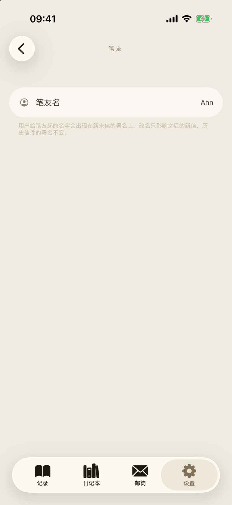

| 图标 | 鸿蒙 `sys.symbol.` | 行 | 右边 | 点了 | 存哪 · 默认 |
|---|---|---|---|---|---|
|  | `person` | 笔友名 | **行内直接是输入框**（右对齐，占位「写一个名字」），不弹窗、不进新页 | 点了键盘弹起，键盘回车键是「完成」；最多 16 个字，多了截掉 | `penPalName` · 空（U11：没起名前叫「笔友」，首启起名不能跳过） |

- **什么时候算改好**：按「完成」，或者**没按完成直接离开这一页**也算
- **清空了就当没改**：去掉首尾空白后是空的 → 输入框恢复成原来的名字
- 组下面小字「用户给笔友起的名字会出现在新来信的署名上。改名只影响之后的新信，历史信件的署名不变。」（v1 R-SETTINGS-05）

---

## 九、位置与天气

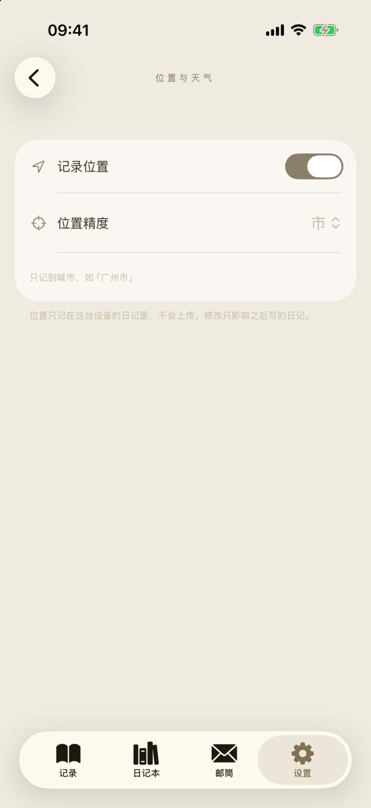 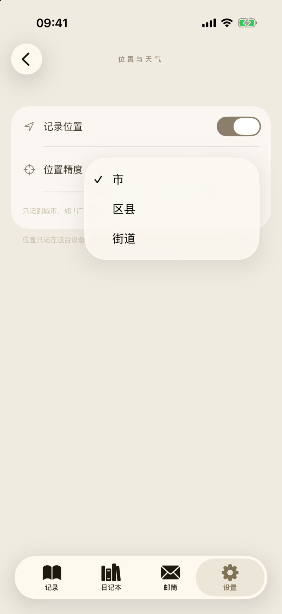 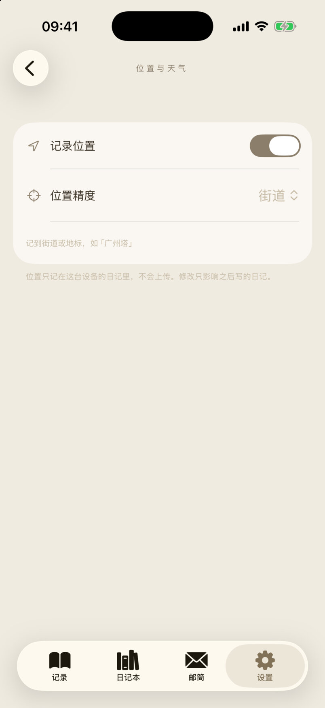

| 图标 | 鸿蒙 `sys.symbol.` | 行 | 右边 | 点了 | 存哪 · 默认 |
|---|---|---|---|---|---|
|  | `local` | 记录位置 | 开关 | 关了**只是不记地点，天气照常取** | `locationRecordingEnabled` · 开 |
|  | `scope` | 位置精度（「记录位置」开着才有） | 当前档「市」/「区县」/「街道」+ 上下小箭头 | **行尾小菜单**（截图中）：市、区县、街道三项，当前项前面打勾；选了立刻生效 | `locationPrecision` · `city`（另两档 `district` / `street`） |
| — | — | （卡片里的一行说明，跟着档位变） | — | 市：「只记到城市，如「广州市」」；区县：「记到区县，如「广州市 天河区」」；街道：「记到街道或地标，如「广州塔」」 | — |

- 组下面小字「位置只记在这台设备的日记里，不会上传。修改只影响之后写的日记。」
- **改了只影响之后写的日记**：已经存下的地名是一段文字（`locationInfo`），不会回头重算
- 三档在写日记页里拼成什么样、出在哪，见第十二节

---

## 十、语言（首页直接推入）

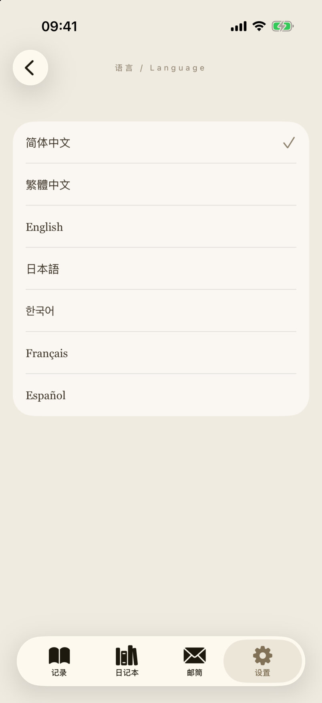

- 顶上小标题「语言 / Language」（**两种语言并排，不翻译**，看不懂当前语言的人也找得到）
- 一组七行：简体中文 / 繁體中文 / English / 日本語 / 한국어 / Français / Español，**每种用它自己的文字写**；当前那行右边  `checkmark`（强调色）
- 🔴 **没有「跟随系统」**（v1 多语言规则）
- 点了立刻换，**整个 App 当场跟着变、不退回首页**（导航栈保留，你还停在这一页）

---

## 十一、尺素会员（付费页、会员页）

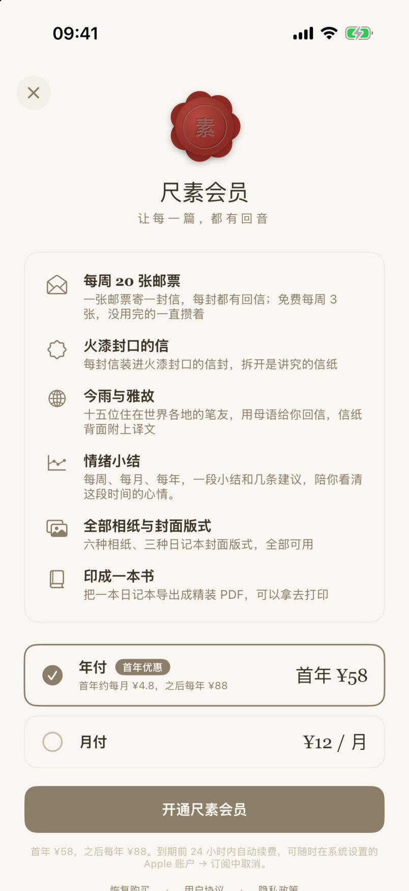

### 付费页（没开通时点「尺素会员」，或点任何会员款）

- **全屏盖**，往下拖关不掉；左上角圆形  `xmark` 关闭
- 从上到下：**68vp 火漆印**（压昵称首字，没登录 / 没昵称压「素」；图片和压字规格见 `../icons/ICONS.md`「火漆印」）→「尺素会员」→「让每一篇，都有回音」→ 六条权益（图标见下表）→ 年付 / 月付两张方案卡 →「开通尺素会员」→ 一段自动续费说明小字 → 一行「恢复购买 · 用户协议 · 隐私政策」
- 「用户协议」「隐私政策」→ **半屏弹窗**看全文
- 连不上商店：方案卡位置显示「暂时无法连接 App Store，请稍后再试」（鸿蒙改成华为的说法，按 U02）

| 图标 | 鸿蒙 `sys.symbol.` | 权益 |
|---|---|---|
|  | `envelope_open` | 每周 20 张邮票 |
|  | `seal` | 火漆封口的信 |
|  | `worldclock` | 今雨与雅故 |
|  | `point_bottomleft_forward_to_point_topright_scurvepath` | 情绪小结 |
|  | `picture` | 全部相纸与封面版式 |
|  | `ebook` | 印成一本书 |

方案卡：选中  `checkmark_circle_fill`，没选  `circle`。价格、首年优惠、支付流程按 U02 / U04。

### 会员页（开通了点「尺素会员」，推入）

- 顶上 **60vp 火漆印**（压昵称首字）+「尺素会员」
- 「方案」、「有效期至」两行 →「管理订阅」（iOS 是系统的订阅管理页；鸿蒙按 U02）→「恢复购买」
- 下面小字「换方案、退订都在「管理订阅」里。退订后，已经用上的相纸和封面会保持原样。」
- 测试包多一组「关闭测试会员」，正式包没有

---

## 十二、此时此地（天气 + 地点）：显示在哪、长什么样、怎么弹

设置里管开关和精度（第九节），真正出现在写日记页和读日记的地方。

### 写日记页里的「此时此地」

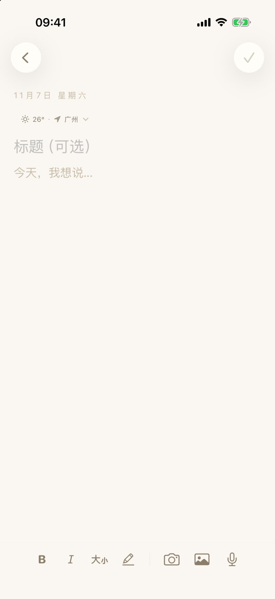 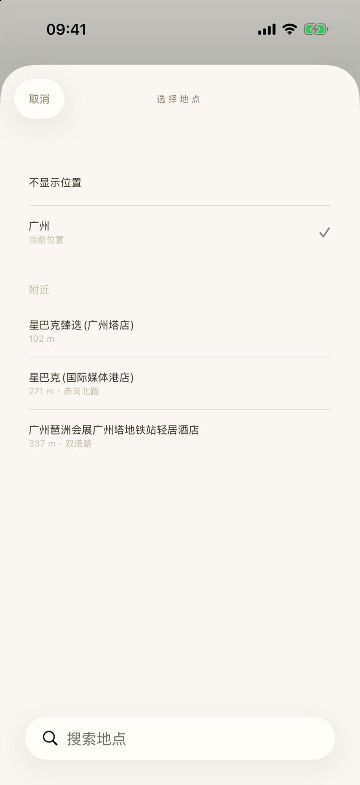

位置：写日记页**日期那一行下面、标题上面**，靠左一个圆角胶囊（卡片底色）。进写日记页自动开始取（草稿里存过就用草稿那份、不重新取，v1 R-ENTRY-05）。这一处有五种样子：

| 状态 | 显示 | 点了 |
|---|---|---|
| 正在取 | 一行灰字「正在获取此时此地…」 | — |
| 取到了 | 胶囊：天气图标 + 「26°」+「·」+ 小定位 + 地名，最后一个  `chevron_down`；选了「不显示位置」时胶囊里没有地名，最后换成  `local_slash_fill` | **选择地点，半屏弹窗**（下面） |
| 天气没取到（地点取到了） | 胶囊照常，下面隔 8vp 一行灰字： `arrow_clockwise`「天气没取到，点这里重试」，再下面一行淡一点的**错误码（域 + 码）**，太长中间省略 | 重新取（v1 R-PLACE-04） |
| 定位权限被拒 |  + 灰字「定位已关闭，去设置里开启」 | 跳系统设置（v1 R-PLACE-03） |
| 还没取过 / 取不到 | 开着记录位置： `local`「记录天气与位置」；关了记录位置： `thermometer_medium`「记录天气」 | 重新取 |

### 选择地点（点胶囊弹出）

- **半屏弹窗**；顶上居中小标题「选择地点」，左上角「取消」；**搜索框在弹窗最底下**（截图右；iOS 26 系统就这么放，鸿蒙放顶上也行）
- 第一组：「不显示位置」；「当前位置」—— 这一行**大字是自动取到的地名**（按设置的精度拼好的，比如「广州」），小字「当前位置」
- 第二组，组上面小标题「附近」（搜索时变「搜索结果」）：
  - 没在搜：**以当前位置为中心 500 米**内的地点，**按距离从近到远**
  - 在搜：以当前位置为中心 **5 公里**范围按关键字搜；停止输入 **300 毫秒**后才搜（不要每敲一个字搜一次）
  - 每行大字是地点名，小字是「102 m · 天河区 赤岗北路」（不到 1 公里写米，否则「1.2 km」；后面是区 + 路）
  - 正在找：转圈 +「正在找附近的地点…」；没有：「附近没有找到地点」/ 搜不到：「没有匹配的地点」—— **搜不到不算出错**，不弹提示条
- 当前选中的那行右边  `checkmark`（强调色）
- 点任何一行：轻震一下、**弹窗马上关**、胶囊换成选的那个
- 存进日记的就是选的那段文字：「当前位置」= 自动拼的地名；「不显示位置」= 不存地名（天气照存）；附近的地点 = 那个地点的名字
- 鸿蒙：附近地点用 Map Kit 的地点搜索（v1 `01_TECH_STACK_MAPPING.md`「需核实」那一行）

### 地名按精度怎么拼（R-PLACE-06）

拿逆地理编码的结果（iOS `CLPlacemark`；鸿蒙 Location Kit `geoLocationManager` 的逆地理，字段名在 DevEco 里对一下）按档拼，**每一档取不到就往上一级退，绝不存空字符串**：

| 档 | 拼法 | 例子 |
|---|---|---|
| 市 `city` | 城市；没有城市（直辖市常见）就用省 / 直辖市那一级 | 广州市 |
| 区县 `district` | 城市 + 空格 + 区县；没有区县就只要城市 | 广州市 天河区 |
| 街道 `street` | 有**地标 / 店名**就只用它（最有记忆点）；否则 区县 + 空格 + 路名门牌；路名也没有 → 城市 + 区县 → 城市 | 广州塔 / 天河区 天河路385号 |

（模拟器的逆地理只给到「广州」，所以截图里三档看不出区别；真机才看得到。）

### 读日记时显示在哪

同一个标记（天气图标 + 温度 +「·」+ 小定位  `local_fill` + 地名），**缺哪项就少显示哪项**，只有地名时不要「·」，全空就整个不显示：

| 位置 | 样子 |
|---|---|
| 写日记页 | 上面那个胶囊（第三级文字色、小号字） |
| 记录页 · 列表的每一行 | 最下面一行，日记本标签右边、靠右，第三级文字色，图标 10vp |
| 记录页 · 大屏卡片 | 卡片文字区最下面，用卡片上那一层字的颜色 |
| 日记详情 | 素笺主题（和纸布局）：星期后面一条竖线「\|」再接这个标记；其他主题：日期和心情下面单独一行 |
| 精装 PDF | 每一篇的篇末一行字「地名 · 温度」，不画图标（U08） |
| 寄出去的信的邮戳 | 邮戳上的地名取这几篇日记里的地名（v1 / U05） |

- **编辑已有日记时不能改**此时此地（编辑页没有这个胶囊）
- 图标大小：天气图标比那一行的字小一号，地名前的小定位再小 1；颜色跟着那一行的字
- **天气图标**：日记里存的是 iOS 的天气名（`weatherCode`），鸿蒙显示时按 `../icons/ICONS.md` 第三节的表换成鸿蒙图标；鸿蒙自己写天气时写成 iOS 认得的名字（R-PLACE-08）
- 天气一小时内、3 公里内沿用上一次的，不重复调天气服务（U14）

---

## 十三、数据与备份

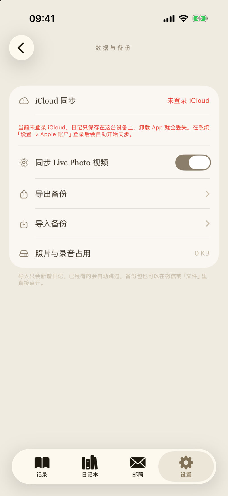 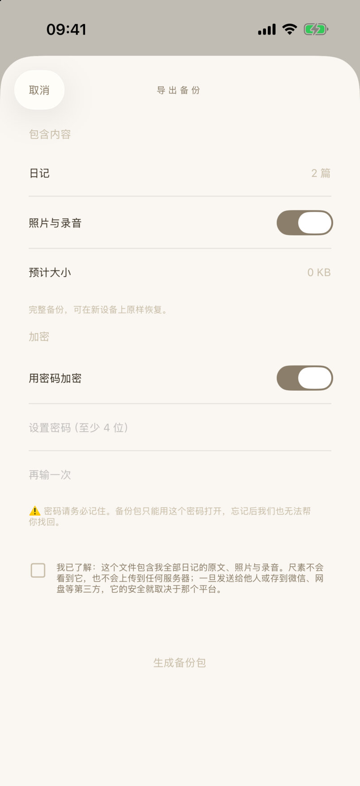 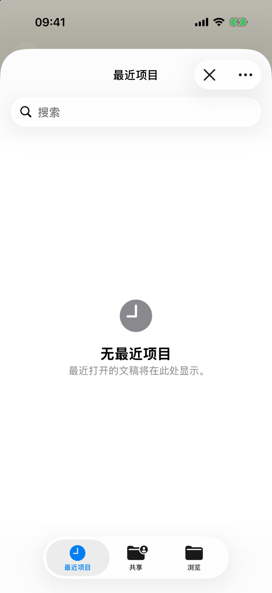

一组，从上到下：

| 图标 | 鸿蒙 `sys.symbol.` | 行 | 右边 | 点了 |
|---|---|---|---|---|
|  /  | 同步正常 `icloud`，不正常 `exclamationmark_cloud_fill` | iCloud 同步（鸿蒙按自己的同步方案改名，v1 Q3） | 状态一句话：正常时强调色，不正常时红色 | 不能点。下面卡片里一段说明（不正常时红字）。🔴 **只有真的同步成功过才能说「已同步」**（v1 R-DATA-05） |
|  | `livephoto` | 同步 Live Photo 视频 | 开关 | 🔴 **鸿蒙不做**（v1 Q10，`syncLivePhotoVideos` 是死设置） |
|  | `share` | 导出备份 | `>` | **导出页，半屏弹窗** |
|  | `download` | 导入备份 | `>` | **直接弹系统文件选择器**（截图右，能选尺素备份包和 .zip）→ 选好 → **导入页，半屏弹窗**；选择器报错 → 顶部提示条「打不开这个文件」 |
|  | `externaldrive` | 照片与录音占用 | 大小（「12.3 MB」），算好之前「统计中…」 | 不能点。进页面后在后台扫一遍，不要在画页面时扫 |
|  | `clean` | 清理 N 个残留文件（**有残留才出现**） | 能腾出多少（强调色） | **底部确认**：标题「清理 N 个残留文件，释放 X MB？」，说明「这些文件不属于任何一篇现存日记，删除不会影响你的内容。」，红字「清理」+「取消」 |

- iOS 的同步状态有六种说法（检查中 / 未登录 iCloud / iCloud 受限 / iCloud 暂不可用 / 同步异常 / 已同步 / 尚未备份），每种下面一段说明 —— 鸿蒙的同步方案定了以后照这个思路写自己的，**没同步成功时一定要说清「此刻卸载会丢」并指向导出备份**
- 组下面小字「导入只会新增日记，已经有的会自动跳过。备份包也可以在微信或「文件」里直接点开。」；有残留文件时再加一段「残留文件是已删日记留下的照片或录音，不再属于任何一篇日记，清理不会影响现有内容。」

### 导出页（半屏弹窗，左上角「取消」，小标题「导出备份」）

1. 「包含内容」：日记 N 篇 /（有来信时）来信 N 封 / 照片与录音（开关，默认开）/ 预计大小。开着照片与录音、又超过 80 MB → 卡片里一行  `exclamationmark_triangle`「超过 80 MB，微信可能发不出去。……」。组下面小字按开关变：「完整备份，可在新设备上原样恢复。」/「只导出文字，……」
2. 「加密」：用密码加密（开关，默认开）→ 开着时两个密码框「设置密码（至少 4 位）」「再输一次」，不一致时红字「两次输入不一致」。组下面小字按开关变（两句都以 ⚠️ 开头）
3. 「我已了解：这个文件包含我全部日记的原文、……」—— 前面一个勾选框：没勾  `square`，勾上  `checkmark_square_fill`。**不勾不能导出**
4. 「生成备份包」（条件不满足时灰）→ 打包中「正在打包…」转圈 → 生成后这一格变成  `share`「分享备份包（12.3 MB）」→ **系统分享面板**；下面小字「已生成。可以发给自己、存进「文件」，或用隔空投送传到另一台设备。」（鸿蒙把「隔空投送」换成「华为分享」）

包里写什么照 v1 `modules/08_backup_package.md` + U15 + U16。

### 导入页（半屏弹窗，小标题「导入备份」，左上角「取消」；**导入进行中不能往下拖关**）

按阶段换内容，照 v1 R-DATA-01 ~ 03：

1. 打开中 → 2. 加密的包：「这个备份包加密了」+ 密码框「备份包密码」+「解锁」，错了红字「密码不对，再试一次」；说明「请输入导出时设置的密码。密码只在这台设备上用于解开文件，不会上传。」→ 3. 预览「备份包内容」（日记 / 来信 / 照片与录音「N 个」或「未包含」/ 导出时间 / 来源设备「iPhone」或「鸿蒙设备」）+「开始导入」→ 4. 导入中（「导入过程中请不要退出尺素。」）→ 5. 完成：新增日记 / 跳过（已存在）/ 新增来信 / 新增日记本 + 一句去哪看看的话（按导入了什么变：「可以去日记本和信箱看看了。」/「可以去信箱看看了。」/「可以回到日记本看看了。」）
- 有同名日记本（且两边都有要新增的日记）→ **屏幕中间的弹窗**：标题「有同名的日记本」，说明「备份包中这些日记本与这台设备上的重名：……。若作为新日记本导入，名字后面会加上序号。」，按钮「合并到同名日记本」「作为新日记本导入」「取消」（v1 R-DATA-03）

---

## 十四、写作统计（内容页）

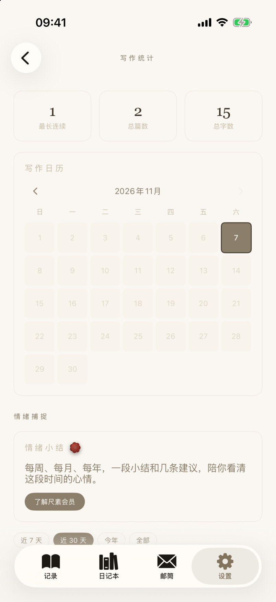 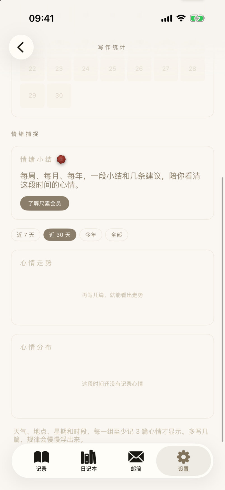

- 内容页，**不用设置那组页面底色**（用主题自己的背景）
- 上半：三张小卡「最长连续 / 总篇数 / 总字数」（U16）→「写作日历」：顶上  `chevron_left`「2026年11月」 `chevron_right` 翻月（到本月右箭头变淡点不动），写过的那天实心（v1 R-SETTINGS-06）
- 下半「情绪捕捉」（U14）：第一张「情绪小结」卡片 —— 不是会员时标题后面一枚 15vp 会员小标记、正文一句介绍、按钮「了解尺素会员」（点了**付费页，全屏盖**）；下面「近 7 天 / 近 30 天 / 今年 / 全部」四个胶囊切范围（默认近 30 天）→ 心情走势 → 心情分布 → ……；数据不够时卡片里一句灰字（「再写几篇，就能看出走势」）

---

## 十五、关于

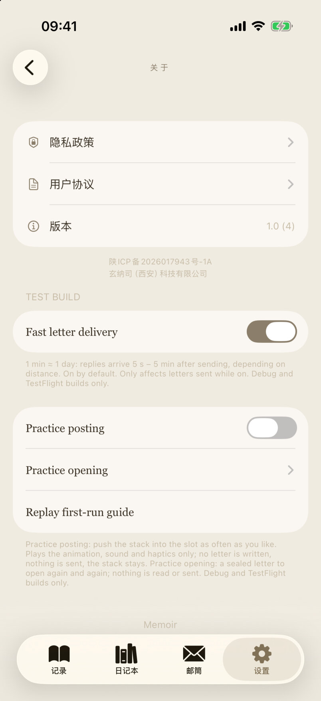

| 图标 | 鸿蒙 `sys.symbol.` | 行 | 右边 | 点了 |
|---|---|---|---|---|
|  | `info_shield` | 隐私政策 | `>` | 推入全文页。**正文放在 App 里、不联网**（没网也打得开；审核必查） |
|  | `doc_text` | 用户协议 | `>` | 同上 |
|  | `info_circle` | 版本 | 「1.0 (4)」= 版本号 + 括号里构建号，从安装包读，不写死 | 不能点 |

- 组下面居中两行小字：ICP 备案号、主办单位（合规要求，**放小字里不单开一行**）
- 页面最底下居中「Memoir」/「by Sinara」
- 截图里中间那两组英文（TEST BUILD：Fast letter delivery、Practice posting、Practice opening、Replay first-run guide）**只在测试包里有**，正式包看不到；鸿蒙测试包要不要做同样的几个按 v1 / U13 的测试开关，正式包一律没有

---

## 十六、截图清单

| 文件 | 是什么 |
|---|---|
| `01_settings_home.jpg` / `02_settings_home_bottom.jpg` | 设置首页（没登录、没开会员）上半 / 下半 |
| `03_appearance.jpg` / `04_appearance_homemode_menu.jpg` | 外观；「手记页」的行尾小菜单 |
| `05_theme_picker.jpg` / `06_theme_intro_sheet.jpg` | 主题选择；点「皮革」弹出的主题介绍（半屏那一档；模拟器上桌面图标恰好已是皮革那张，所以主按钮是灰的「图标已是这一套」） |
| `07_app_icon_picker.jpg` | 应用图标 |
| `08_journal.jpg` / `09_journal_dormant_menu.jpg` / `10_journal_time_popover.jpg` | 日记（提醒开着）；封条天数小菜单（鸿蒙不做）；时间的小气泡 |
| `11_paper_style_picker.jpg` | 照片相纸样式（不是会员，后四种带会员小标记） |
| `12_penpal.jpg` | 笔友 |
| `13_location.jpg` / `14_location_precision_menu.jpg` / `14b_location_street.jpg` | 位置与天气；精度小菜单（市 / 区县 / 街道）；选了街道后说明那行跟着变 |
| `15_language.jpg` | 语言 |
| `16_data.jpg` / `17_backup_export.jpg` / `17b_backup_import.jpg` | 数据与备份（模拟器没登 iCloud，所以是红字）；导出页；导入的系统文件选择器 |
| `18_stats.jpg` / `18b_stats_mood.jpg` | 写作统计上半 / 往下滑的情绪捕捉 |
| `19_about.jpg` | 关于（测试包，带 TEST BUILD 两组） |
| `20_paywall.jpg` | 付费页 |
| `21_login_sheet.jpg` | 登录页（鸿蒙换华为账号，U02） |
| `22_compose_place_badge.jpg` / `23_location_picker_sheet.jpg` | 写日记页的此时此地胶囊；点开的选择地点 |
